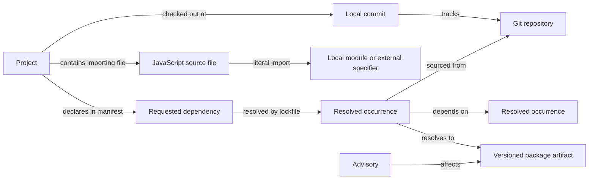

# Architecture and coverage

## Purpose and boundary

One portfolio view should answer: **Which projects use this package or repository, at which resolved version or commit, through which path, and what changed since the last accepted snapshot?** It should also show when the evidence is missing or stale. The public skill is the reusable method and local starter; each user's project registry, credentials, snapshots, acknowledgement history, and notification channels remain outside the public repository.

The sample CLI covers npm lockfiles, pnpm v9 snapshots, root JavaScript declarations, literal source imports and root HTML import maps, workflow actions, Git submodules, root Python requirements, and local Git metadata. An opt-in enrichment step queries OSV by resolved npm name and version, plus public npm metadata for deprecation and the `latest` tag; a separate pass fetches OSV advisory details. It does not claim to scan every ecosystem or detect every vulnerability. A portfolio is only fully covered after each configured project's applicable adapters have run successfully and their freshness targets are met. Discovery is bounded to explicitly selected parent directories and produces candidates for review. A scan root can be a repository or nested package root; a production registry should separate products, repositories, workspaces, and duplicate checkouts.

## Required system pieces

| Piece | Responsibility | Minimum evidence |
| --- | --- | --- |
| Portfolio registry | Explicit project IDs, roots, repo URLs, visibility, owner, environment, and scan cadence | Local config or private registry; no inferred disk-wide scan |
| Discovery and root editor | Find missing sources under selected parent paths, classify nested manifests, and attach a directory to a stable ID | Candidate path, evidence files, parent repo, accepted edit, rescan time |
| Collectors | Parse package manifests and lockfiles, local Git checkouts, GitHub Actions, Git submodules, container images, and build SBOMs as applicable | File path, hash, commit, observed time, parse status |
| Remote enrichment | Resolve live GitHub refs and release metadata; query package registry versions and advisory sources | URL, fetched time, response identity, rate-limit and failure status |
| Graph store | Preserve project, occurrence, versioned artifact, repository, and advisory identities with typed, sourced edges | Versioned schema plus immutable snapshots |
| Policy engine | Generate actionable findings from known vulnerabilities, version drift, mutable refs, unsupported formats, failed scans, and stale data | Rule ID, severity, affected projects, path, evidence, remediation |
| Dashboard | Portfolio coverage, focused graph, dependency path, version history, and alert queue | Exportable JSON and accessible tables |
| Notifier | Diff snapshots and send changes to configured channels with acknowledgements and suppressions | Stable event ID, delivery receipt, retry state |

An initial deployment can use SQLite for normalized graph facts and alert state plus immutable JSON snapshots for audit and static rendering. A graph database is optional; it is useful only if path queries across a large portfolio outgrow SQLite. The collector should not need a hosted service to produce a local report.

## Graph identity

Keep source-import evidence separate from resolved package artifacts. A literal source import identifies a local module or external specifier; a browser import map URL may provide a version hint. Neither proves that remote code was fetched or checked for advisories. The starter records partial source coverage when its per-project file limit or a read error prevents a complete scan. Dynamic expressions, bundler aliases, and runtime loading need additional adapters.

Use a project ID stable across path moves. An occurrence key includes project ID, manifest identity, and install location or workspace importer. The artifact key includes ecosystem, canonical package name, exact version, and, where necessary, source digest. This keeps two installs of the same version distinct when their dependency paths or provenance differ. A Git source key is host plus owner/repository; a Git reference is a separate node carrying branch, tag, or exact commit. Store evidence on edges. Never turn a requested semver range into an installed version.

Each snapshot should include `schemaVersion`, `generatedAt`, `coverage`, `nodes`, `edges`, and `findings`. An edge needs `from`, `to`, `kind`, `scope` when relevant, and source evidence. A finding needs a stable rule/advisory ID, affected artifact, impacted projects, at least one shortest path from a project, observed version or commit, source URL, `firstSeen`, `lastSeen`, state, severity, and remediation status. The starter emits a smaller schema; extending it should preserve versioned migrations.

## Source adapters

1. **JavaScript:** Parse `package.json` and the actual lockfile for npm, pnpm, Yarn, Bun, or Deno. Do not merge different lockfile semantics into one parser. npm's `packages` map in lockfile v2/v3 records resolved locations, versions, source, and integrity; the top-level manifest records requested ranges. The starter reads pnpm v9's project document, importers, and snapshots with a conservative parser; unsupported references are coverage findings. For npm workspaces, capture importer and symlink relationships explicitly. Use `npm sbom` or a build-generated SBOM as a cross-check where appropriate, not as a replacement for path evidence.
2. **GitHub and Git:** Record local `HEAD`, branch, origin, and cached tracking ref. A cached tracking ref does **not** prove live remote status. The opt-in remote collector fetches default branch SHA, releases, tags, and compare status through GitHub APIs, with pagination, ETags, token permissions, and retry/rate-limit handling. Compare commits, not release names, for checkout drift. Treat branch and tag references as mutable; distinguish an exact pinned commit. Track Git submodules, Git URLs in package manifests/locks, and GitHub Actions `uses` references separately.
3. **Other ecosystems:** Add adapters according to the actual portfolio: Python (`uv.lock`, Poetry, requirements), Rust (`Cargo.lock`), Go (`go.mod`/`go.sum`), .NET (`project.assets.json`/NuGet), containers (digest-pinned images), and generated SBOMs. Record unsupported or unavailable sources rather than silently dropping projects.
4. **Advisories:** Query OSV by package ecosystem/name/version or commit, or import GitHub Dependabot alerts when authorized. The starter's batch query returns IDs; its optional detail pass fetches summary, source severity, and fixed boundaries. Deduplicate aliases such as GHSA and CVE, retain advisory modification time and withdrawal state, and re-evaluate against the resolved artifact. A fixed boundary is a remediation lead, not a validated update plan. A vulnerability feed is not the same as an update feed. If a source is unavailable, mark advisory coverage unknown.

## Alert policy

| Signal | Typical trigger | Default treatment |
| --- | --- | --- |
| New known vulnerability | Advisory newly affects a resolved artifact | Alert with severity from source, impacted paths, fixed version if known |
| Lockfile or commit change | Resolved version, integrity, or pinned SHA changes | Change event; highlight additions and removals |
| Remote drift | Local or pinned commit differs from a live selected ref | Informational until compare status and owner policy establish action |
| New release | New upstream package or repository release | Digest or queue item, not automatically a security alert |
| Mutable source | Branch/tag dependency or unpinned GitHub Action | Policy finding with exact source path |
| Coverage failure | Missing/unsupported lockfile, auth failure, stale scan | Coverage alert; never present as zero risk |

Use a finding key such as `rule-or-advisory ID + artifact identity + project ID`; use event keys that include transition and observed version for delivery deduplication. Keep acknowledgements, snoozes, suppressions with reason and expiry, and delivery receipts in a separate local/private state store. Send a high-priority notification only for newly actionable findings or materially worsened impact; group routine version updates into a digest. A GitHub issue, email, Slack message, or webhook needs explicit configuration and authorization. Failed sends retry with bounded backoff and never change the underlying finding state.

## Dashboard views

- **Portfolio overview:** project rows with last successful scan, supported source coverage, number of open findings by severity, and freshness. A zero means “checked and none found”; unknown is shown separately.
- **Focused network:** provide JavaScript request, source import, resolved npm/pnpm, and GitHub source lenses for a selected project or the portfolio. Bubble advisory, deprecation, newer `latest` tag, unknown lookup, and local coverage filters above the graph. Label columns and show visible nodes and edges. Fit the graph to the viewport, allow zoom and scrolling, and search for exact project paths and immediate sources. Click a node or edge for its scope, version, source file, and lookup time. Keep the graph bounded; the full graph stays in JSON/table form.
- **Artifact detail:** requested range versus resolved version, integrity or commit, source, direct/transitive scope, all dependent projects, and evidence links.
- **Version history:** timeline of observed package versions, Git commit changes, upstream releases, and advisory publication/withdrawal. Label observations separately from upstream events.
- **Alert queue:** new, acknowledged, suppressed, and resolved states with owner, policy reason, impact path, evidence freshness, and remediation link.

Color is only a redundant cue. Use labels and shapes for project/package/repository/advisory types and alert states. Keep the network keyboard accessible and provide an equivalent table and JSON export. The sample dashboard implements a focused network, inventory, and coverage as a local prototype. Its local editing server can save a root and rescan without external lookups. It also stores basic open, investigating, or acknowledged notes in a private JSON file. It does not establish resolution from a user's status choice, or persist ownership, expiring suppression, remediation decisions, or notification receipts. A production triage store needs stable finding identity across scans. The static HTML is read-only.

## Implementation order

1. Inventory the explicitly selected projects and their manifest/lockfile formats. Define coverage targets and classify private versus publishable outputs.
2. Stabilize the graph schema and snapshot diff using fixture projects that test hoisting, nested versions, workspace links, git dependencies, and missing locks. Add parser adapters for formats actually present.
3. Add opt-in GitHub and advisory enrichment with token scopes, ETag caching, rate-limit handling, source timestamps, and offline failure states.
4. Add persistent alert state and one user-selected delivery channel. Exercise deduplication, acknowledgement, recovery, and stale-source behavior before scheduling it.
5. Deploy local scheduled scans or CI per repository, then publish only a redacted dashboard if desired. Keep remote writes and notification delivery separate from read-only collection.

## Source documentation

- [npm package-lock format](https://docs.npmjs.com/cli/v11/configuring-npm/package-lock-json) and [npm install range/lock behavior](https://docs.npmjs.com/cli/v11/commands/npm-install)
- [pnpm lockfile reading guide](https://github.com/pnpm/pnpm/blob/main/pnpm/docs/lockfile.md) and [pnpm v9 format](https://github.com/pnpm/spec/blob/master/lockfile/9.0.md)
- [GitHub supported dependency ecosystems](https://docs.github.com/en/code-security/reference/supply-chain-security/dependency-graph-supported-package-ecosystems) and [dependency submission API](https://docs.github.com/en/rest/dependency-graph/dependency-submission)
- [GitHub Dependabot alerts API](https://docs.github.com/en/rest/dependabot/alerts), [releases API](https://docs.github.com/en/rest/releases), and [commit comparison API](https://docs.github.com/en/rest/commits)
- [OSV API](https://google.github.io/osv.dev/api/)
